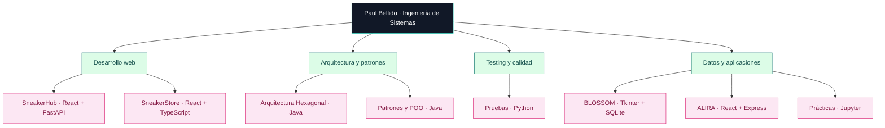

 

  

  

**Diseño soluciones donde el código, los datos y la ingeniería trabajan juntos.**

`Desarrollo Full Stack` · `Arquitectura de software` · `Bases de datos` · `Pruebas` · `Integración y despliegue`

---

## 👨‍💻 Sobre mí

Soy **Paul Bellido**, estudiante de **Ingeniería de Sistemas** en la **Universidad Nacional de San Cristóbal de Huamanga (UNSCH), Perú**.

Me interesa recorrer todo el ciclo de vida de un producto de software: **entender el problema, modelar una solución, desarrollar, probar, desplegar y mejorar**. Este perfil reúne tanto proyectos funcionales como laboratorios académicos; cada uno documenta una habilidad técnica distinta.

> **Mi enfoque:** comprender las decisiones de diseño, no solo conseguir que el código se ejecute.

---

## 🧰 Tecnologías y herramientas

<table>
<tr><td><b>Frontend</b></td><td></td></tr>
<tr><td><b>Backend y lenguajes</b></td><td></td></tr>
<tr><td><b>Datos</b></td><td> SQL Server · T-SQL · modelamiento relacional</td></tr>
<tr><td><b>Entorno y calidad</b></td><td> Pytest · Vitest · JUnit (en aprendizaje) · CI/CD</td></tr>
</table>

Las herramientas reflejan proyectos documentados y áreas de práctica; no implican dominio experto de todas ellas.

---

## 🚀 Proyectos destacados

### 👟 01 · [SneakerHub — E-commerce Full Stack](https://github.com/paulbellido0990/sneakerhub)

**Comercialización y administración de zapatillas.** Aplicación con catálogo, carrito, pedidos y panel administrativo para productos, existencias y reportes. El repositorio documenta integración entre frontend, API REST y base de datos.

**Tecnologías:** `React` `Vite` `Tailwind CSS` `Python` `FastAPI` `SQLAlchemy` `MySQL` `JWT`

**Áreas trabajadas:** catálogo y filtros · carrito · autenticación y roles · gestión de stock · pedidos · dashboard de negocio.

### 🛍️ 02 · [SneakerStore PRO — Catálogo dinámico](https://github.com/paulbellido0990/SneakerStore)

**Laboratorio IS-882 de Desarrollo Web.** Catálogo académico de zapatillas Nike, Adidas, Jordan y New Balance, con interfaz en español y precios de demostración en **soles peruanos (S/)**.

**Tecnologías:** `React 19` `TypeScript` `Vite` `Axios` `TanStack Query` `React Router`

**Áreas trabajadas:** búsqueda con *debouncing* · filtros combinados · paginación · estado en la URL · caché y *prefetching* · favoritos locales · conexión con DummyJSON.

> Catálogo **demostrativo**, no tienda con pagos o inventario real. Combina 24 modelos de muestra con datos adicionales disponibles desde la API.

### 🧩 03 · [Sistema académico — Arquitectura Hexagonal](https://github.com/paulbellido0990/Labo4_Arqui_Hexagonal)

Laboratorio de **Ports & Adapters** en Java: casos de uso desacoplados de la persistencia, con adaptadores para **JSON** y **PostgreSQL**. El objetivo es cambiar el almacenamiento sin reescribir el núcleo de aplicación.

**Tecnologías:** `Java` `Maven` `JDBC` `Gson` `PostgreSQL`

**Conceptos:** puertos de entrada/salida · inversión de dependencias · adaptadores intercambiables · CRUD académico.

### 🧱 04 · [Patrones de diseño — Java](https://github.com/paulbellido0990/Labo5_arqu)

Prácticas de arquitectura de software enfocadas en la organización de clases y la aplicación de **patrones de diseño** dentro de un sistema académico. Incluyen ejercicios para contrastar distintas formas de creación y colaboración entre objetos.

**Tecnologías:** `Java` `Maven` · diseño orientado a objetos · UML.

### 🧪 05 · Pruebas automatizadas y procesamiento de pagos

Laboratorios con **Python** orientados a validar reglas de negocio y resultados esperados. Los repositorios incluyen módulos de procesamiento y archivos de pruebas, útiles para practicar aserciones, aislamiento y regresión.

### 🌸 06 · [BLOSSOM — Sistema de ventas de escritorio](https://github.com/paulbellido0990/blossom-escritorio)

Aplicación local para Windows, desarrollada en **Python con Tkinter y SQLite**, destinada al registro de ventas, cobros, pedidos, gastos y estadísticas. Su documentación incorpora respaldos, exportación de datos y generación de comprobantes PDF.

**Tecnologías:** `Python` `Tkinter` `SQLite` `Pytest` `PyInstaller` `GitHub Actions`

**Enfoque:** funcionamiento local · persistencia · reportes · copias de seguridad · distribución como ejecutable.

### 📅 07 · [ALIRA — Gestor personal y académico](https://github.com/paulbellido0990/agente_personal)

Sistema web de organización de tareas con dashboard, calendarios, recordatorios, estadísticas y administración de cuentas. El README describe controles de sesión, sincronización mediante servidor y una **PWA**; el proyecto se documenta como **no publicado en producción**.

**Tecnologías:** `React` `Express` `Node.js` `SQLite` `PWA` `Recharts`

**Enfoque:** productividad · autenticación · control de sesiones · gestión de tareas · arquitectura cliente/servidor.

---

## 📚 Laboratorios, prácticas y exploraciones

| Línea de trabajo | Repositorios públicos | Habilidades practicadas |
| :-- | :-- | :-- |
| **Arquitectura de software** | [Laboratorio 03](https://github.com/paulbellido0990/Labo03-Arquitectura-Software) · [Versión limpia](https://github.com/paulbellido0990/Labo03_arqui_limpia) | Organización del código y responsabilidades en Java |
| **Pruebas de software** | [Laboratorio 01](https://github.com/paulbellido0990/laboratorio-01-pruebas) · [Laboratorio 05](https://github.com/paulbellido0990/laboratorio-5-pruebas) · [Semana 06](https://github.com/paulbellido0990/laboratorio-pruebas-s6) | Pruebas y validación de lógica con Python; el Laboratorio 01 no contiene material público sustantivo |
| **Notebooks y prácticas IS-484** | [Práctica 001](https://github.com/paulbellido0990/IS484-Practica001-Lunes-Llallahui-Bellido) · [Laboratorio 001](https://github.com/paulbellido0990/IS484-Labo001-Lunes-Llallahui-Bellido) · [Semana 002](https://github.com/paulbellido0990/IS484-Semana002-Lunes-Llallahui) | Ejercicios computacionales en Jupyter Notebook |
| **Colaboración y control de versiones** | [TallerGit](https://github.com/paulbellido0990/TallerGit) · [TallerGit-Compartido](https://github.com/paulbellido0990/TallerGit-Compartido) | Trabajo con repositorios y Git |

<b>🔎 Ver todos los repositorios públicos revisados</b>

Además de los proyectos destacados y laboratorios enlazados arriba, el propio repositorio de este perfil es [paulbellido0990/paulbellido0990](https://github.com/paulbellido0990/paulbellido0990). La selección de arriba cubre los **17 repositorios públicos** identificados en la revisión del **30 de octubre de 2026**. Para ver el inventario actualizado, usa la [lista de repositorios de GitHub](https://github.com/paulbellido0990?tab=repositories).

---

## 📈 GitHub en números

 

 

> Las tarjetas se generan con servicios externos y muestran estadísticas públicas dinámicas. Pueden fallar temporalmente por límites o disponibilidad del proveedor. El gráfico de lenguajes mide código de repositorios, **no nivel de dominio profesional**; la racha tampoco mide productividad ni calidad.

---

## 🗺️ Mapa de mis áreas de trabajo

---

## 🧭 Cómo abordo un proyecto

| Etapa | Qué busco resolver |
| :-- | :-- |
| **01 · Analizar** | Comprender a los usuarios, el problema y las restricciones |
| **02 · Diseñar** | Definir componentes, entidades, contratos y responsabilidades |
| **03 · Construir** | Implementar incrementos claros y verificables |
| **04 · Probar** | Validar el comportamiento y detectar regresiones |
| **05 · Mejorar** | Refactorizar, documentar y preparar el despliegue |

### 🔭 Próximos aprendizajes

`System Design` · `Arquitecturas mantenibles` · `Pruebas de integración` · `CI/CD` · `Seguridad web` · `Observabilidad` · `Despliegue`

---

### ⚙️ Engineering ideas into working software

**Analizar · Diseñar · Construir · Probar · Mejorar**

  

**Paul Bellido · Ingeniería de Sistemas · UNSCH, Perú**

