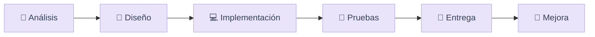

 

**¡Hola! Soy Paul Bellido.** Estudiante de Ingeniería de Sistemas en la Universidad Nacional de San Cristóbal de Huamanga (Perú).

*Desarrollo soluciones a partir del análisis, la arquitectura, la implementación, las pruebas y la mejora continua.*

`Full Stack` · `APIs REST` · `Arquitectura de software` · `Bases de datos` · `Testing` · `Automatización`

[Proyectos destacados](#-proyectos-destacados) • [Lenguajes](#-lenguajes-y-estadísticas) • [Todos los repositorios](#-índice-de-repositorios) • [Contacto](#-contacto)

---

## 🌷 Sobre mí

Combino desarrollo web y backend con diseño de arquitectura, bases de datos y pruebas de software. Mis proyectos abarcan e-commerce, sistemas de gestión, laboratorios de patrones y arquitectura hexagonal, aplicaciones de escritorio y análisis mediante notebooks.

> **Mi enfoque:** comprender el problema → modelar la solución → construirla → probarla → mejorarla.

## 🧰 Tecnologías usadas en mis proyectos

| Área | Tecnologías |
|:--|:--|
| **Frontend** |      |
| **Backend** |      |
| **Datos** |    |
| **Calidad y herramientas** |     |

---

## 📊 Lenguajes y estadísticas

### Distribución porcentual de lenguajes principales

| Lenguaje principal de repositorio | Repositorios | Participación |
|:--|--:|--:|
| Python | 4 | **30.8 %** |
| Java | 4 | **30.8 %** |
| Jupyter Notebook | 3 | **23.1 %** |
| JavaScript | 1 | **7.7 %** |
| TypeScript | 1 | **7.7 %** |
| **Total con lenguaje identificado** | **13** | **100 %** |

> **Metodología, 30/10/2026:** porcentajes calculados sobre los 13 repositorios públicos de los 17 encontrados que tienen lenguaje principal identificado en sus metadatos. Un repositorio puede contener varios lenguajes; **este gráfico no mide bytes, líneas de código ni competencia técnica**. Los cuatro repositorios restantes no tenían un lenguaje principal informado. Jupyter Notebook es la categoría detectada por GitHub para archivos `.ipynb`, que pueden contener Python u otro lenguaje.

### Estadísticas automáticas de GitHub

Las tarjetas anteriores son generadas por servicios externos y pueden incluir reglas de cómputo distintas de la tabla estática. Si el servidor externo no responde, GitHub puede mostrar una imagen rota. No representan actividad en repositorios privados inaccesibles.

---

## 🚀 Proyectos destacados

### 👟 [SneakerHub — Plataforma de e-commerce Full Stack](https://github.com/paulbellido0990/sneakerhub)

**React · Vite · FastAPI · Python · MySQL · Tailwind CSS**

Plataforma de comercio de zapatillas con módulos de catálogo, carrito, pedidos, autenticación, control administrativo de productos e inventario y dashboard con indicadores del negocio. Arquitectura de frontend, API REST y base de datos.

 

### 🛍️ [SneakerStore PRO — Catálogo interactivo](https://github.com/paulbellido0990/SneakerStore)

**React · TypeScript · Axios · TanStack Query · React Router**

Catálogo académico con **24 zapatillas seleccionadas** de Nike, Adidas, Jordan y New Balance, además de consumo REST de DummyJSON. Incluye filtros, búsqueda con debouncing, paginación, favoritos, vista de detalle y precios demostrativos en soles peruanos. No procesa pagos reales.

### 🧩 [Arquitectura Hexagonal — Gestión Académica](https://github.com/paulbellido0990/Labo4_Arqui_Hexagonal)

**Java · Maven · PostgreSQL · JSON**

Aplicación de consola que separa casos de uso, puertos y adaptadores. Gestiona entidades académicas con adaptadores alternativos de persistencia JSON y PostgreSQL.

### 🧱 [Patrones y arquitectura — Laboratorio 05](https://github.com/paulbellido0990/Labo5_arqu)

**Java · Maven · Diseño de software**

Ejercicios académicos de arquitectura y patrones de diseño organizados en un proyecto Java. Complementa el trabajo sobre modularidad, reutilización y diseño orientado a objetos.

### 🌸 [BLOSSOM — Gestión de ventas de escritorio](https://github.com/paulbellido0990/blossom-escritorio)

**Python · SQLite · Aplicación Windows**

Sistema local de ventas, cobros parciales, pedidos, gastos, estadísticas y comprobantes PDF. Incluye respaldos, exportación e instrucciones para compilar un ejecutable para Windows.

### 📅 [ALIRA — Gestor personal de tareas](https://github.com/paulbellido0990/agente_personal)

**React · Express · SQLite · PWA**

Plataforma de organización de tareas, recordatorios, calendario y reportes; incluye controles de autenticación y sincronización mediante un backend central. **Proyecto no publicado en un alojamiento público**, según su documentación.

### 🧪 [Pruebas automatizadas de procesamiento de pagos](https://github.com/paulbellido0990/laboratorio-5-pruebas)

**Python · Pytest · GitHub Actions**

Laboratorio de validación de lógica de pagos y ejecución de pruebas automatizadas. Archivos principales: `procesamiento_pagos.py` y `test_procesamiento_pagos.py`.

---

## 🗂️ Índice de repositorios

<b>👟 Web, producto digital y herramientas (4)</b>

| Repositorio | Enfoque |
|:--|:--|
| [sneakerhub](https://github.com/paulbellido0990/sneakerhub) | E-commerce Full Stack |
| [SneakerStore](https://github.com/paulbellido0990/SneakerStore) | Catálogo dinámico en React y TypeScript |
| [agente_personal](https://github.com/paulbellido0990/agente_personal) | ALIRA, gestión de tareas |
| [blossom-escritorio](https://github.com/paulbellido0990/blossom-escritorio) | Sistema local de ventas |

<b>🏛️ Arquitectura y Java (4)</b>

| Repositorio | Enfoque |
|:--|:--|
| [Labo4_Arqui_Hexagonal](https://github.com/paulbellido0990/Labo4_Arqui_Hexagonal) | Puertos y adaptadores |
| [Labo5_arqu](https://github.com/paulbellido0990/Labo5_arqu) | Laboratorio 05 de arquitectura |
| [Labo03-Arquitectura-Software](https://github.com/paulbellido0990/Labo03-Arquitectura-Software) | Laboratorio 03 |
| [Labo03_arqui_limpia](https://github.com/paulbellido0990/Labo03_arqui_limpia) | Variante de laboratorio 03 |

<b>🧪 Pruebas y validación (3)</b>

| Repositorio | Enfoque |
|:--|:--|
| [laboratorio-01-pruebas](https://github.com/paulbellido0990/laboratorio-01-pruebas) | Inicio del curso de pruebas; repositorio sin lenguaje principal informado |
| [laboratorio-5-pruebas](https://github.com/paulbellido0990/laboratorio-5-pruebas) | Procesamiento de pagos y Pytest |
| [laboratorio-pruebas-s6](https://github.com/paulbellido0990/laboratorio-pruebas-s6) | Payment processor y pruebas en Python |

<b>📒 Notebooks y prácticas de IS484 (3)</b>

| Repositorio | Enfoque |
|:--|:--|
| [IS484-Practica001-Lunes-Llallahui-Bellido](https://github.com/paulbellido0990/IS484-Practica001-Lunes-Llallahui-Bellido) | Notebooks de ejercicios aplicados |
| [IS484-Labo001-Lunes-Llallahui-Bellido](https://github.com/paulbellido0990/IS484-Labo001-Lunes-Llallahui-Bellido) | Laboratorio 01 |
| [IS484-Semana002-Lunes-Llallahui](https://github.com/paulbellido0990/IS484-Semana002-Lunes-Llallahui) | Laboratorio de semana 02 |

<b>🌱 Git, colaboración y perfil (3)</b>

| Repositorio | Enfoque |
|:--|:--|
| [TallerGit](https://github.com/paulbellido0990/TallerGit) | Taller de control de versiones |
| [TallerGit-Compartido](https://github.com/paulbellido0990/TallerGit-Compartido) | Práctica compartida de Git |
| [paulbellido0990](https://github.com/paulbellido0990/paulbellido0990) | README público de perfil |

---

## 🧭 Mi proceso de desarrollo

### En qué sigo profundizando

- Arquitectura mantenible y patrones de diseño.
- Diseño y consumo de APIs REST.
- Persistencia relacional y modelado de datos.
- Automatización de pruebas e integración continua.
- Despliegue, confiabilidad y documentación técnica.

---

## 🤝 Contacto

**Paul Bellido · Ingeniería de Sistemas · UNSCH**

*Construir software también es aprender a hacerlo mejor.*

